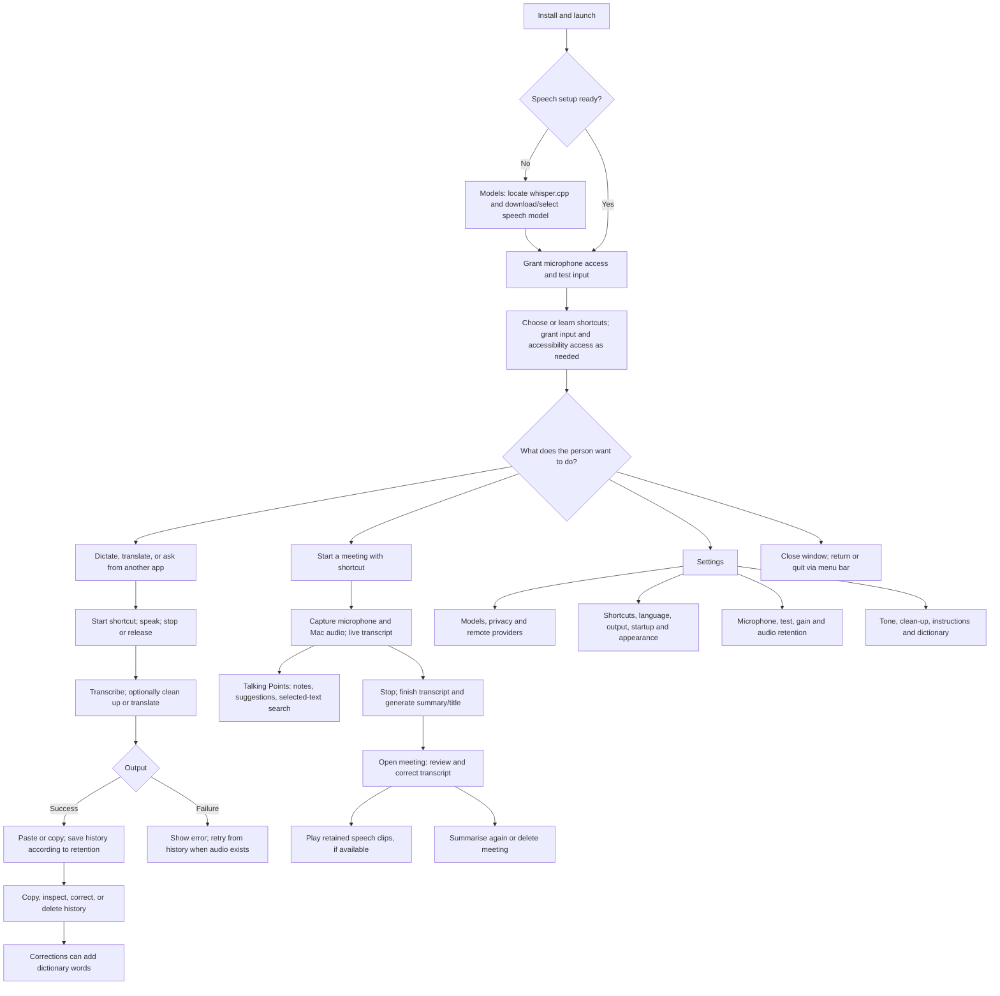

# OpenDictate: launch UX sweep and flow map

**Reviewed:** 17 November 2026  
**Scope:** macOS app, current working tree based on `6b3a846`, including the installed, uncommitted meeting-notes and playback changes.  
**Method:** source and state review, current screen captures, and evidence from the owner's recent meeting tests. This is a heuristic review, not a usability study or a complete VoiceOver, permissions, performance, or clean-install test. Labels below distinguish observed behavior from risks to validate.

## Product flow map

## Flow inventory

| Journey | Entry → successful outcome | Recovery and important branches |
|---|---|---|
| Install / first launch | Install app → Home indicates speech readiness → Models → locate program, download and select model → test dictation. | Missing executable, model download, OS permissions, and an unavailable text engine each require separate diagnosis. No end-to-end first-run checklist was found. |
| Permissions / readiness | Start or test mic → macOS permission → Audio input meter; accessibility/input monitoring may be needed for shortcuts and pasting. | Audio settings link to microphone privacy. Global shortcuts and system-audio permissions need clearer in-context guidance and verification. |
| Choose speech engine | Models → local whisper.cpp + GGML model, or OpenAI-compatible service → select/configure → health status. | A downloaded model and the whisper program are separate requirements. A cloud service adds URL, model and potentially key. |
| Choose text engine | Models → Ollama, compatible server / LM Studio, or Off → pick model or download → test. | Optional for plain dictation, required for Translate, Ask and model-generated meeting features. A model download, server running and selection are distinct states. |
| Dictation | In destination app, invoke shortcut → speak → stop/release → transcribe → optional clean-up → paste or copy. Home also has a start/stop button. | Silence gives neutral feedback. Microphone errors are surfaced; automatic paste may fail and report copied text. Target focus should be validated, especially for Home-button initiation. |
| Translation | Configure target language and text model → invoke Translate shortcut → speak → stop → paste/copy translated result. | Missing or unavailable text engine blocks the mode; target language is in General settings. |
| Ask anything / rewrite | Optionally select text → Ask shortcut → speak instruction → result pasted/copied. | When selection capture fails or is empty, intent can be ambiguous; test with slow apps, protected fields and no selection. |
| Shortcut configuration | Settings → General → choose toggle or hold → add a shortcut → press one key, modifier combination or two ordinary keys. | Conflict and permission errors are shown; users need a way to learn and test the chosen shortcut without leaving setup. Meeting remains toggle-only. |
| Microphone test / recovery | Settings → Audio input → select mic → test level / change gain. Missing configured input falls back to default. | During capture the app attempts recovery; no available input or open failure produces an error. Silence in mic test is currently described as definite macOS blocking. |
| Start and monitor meeting | Meetings shortcut → capture system output and microphone → live transcript and separate Talking Points window → Stop. | Empty meeting screen explains the shortcut; populated meeting list has no visible start button. Recording is source-channel based, not individual speaker recognition. |
| Live Talking Points | While meeting runs → view transcript and model notes/suggestions → select text to copy or search with configured Brave key. | Disabled / unavailable model, insufficient memory, missing cloud opt-in and search failure have states. Search sends selected text externally. Verify suggestions and action ownership against transcript. |
| Finish meeting and summary | Stop → saved meeting → automatic summary/title → inspect decisions, actions, open questions, key points and transcript. | Empty transcript shows an error; summary can be retried. Title failure can silently preserve the timestamp. Stored earlier summaries do not automatically regenerate after a product update. |
| Correct / replay meeting | Open meeting → click transcript line → edit/save → summary marked stale → Summarise again. If retained clips exist, Play or Stop. | Hover reveals correction affordance. Saved audio is selected speech clips rather than a complete continuous recording; current playback has no pause, seek or transcript-linked playback. |
| Delete meeting | Open meeting → Delete → meeting directory removed. | No confirmation or undo was found on this path; deletion includes retained audio and transcript. |
| History / retry | History → filter by mode → copy, expand, correct or delete an item; failed items with retained audio offer Retry. | Clear all and shorter retention prune data. Retry is available only while failure audio remains; corrections may update dictionary. |
| Dictionary and personalization | Dictionary → add, search, filter or remove a term; or correct History to learn terms → Settings → tone and clean-up. | Term removal is revealed on hover. The meeting transcription server currently may not honor the dictionary prompt; dictation and meetings may differ. |
| Privacy / retention | History retention selector; meeting audio retention in Audio input; local/cloud provider choice in Models; About opens data folder. | Meetings and dictation have separate retention rules. Talking Points requires an opt-in for a nonlocal text server, but other configured cloud processing and external search need clear, contextual disclosure. |
| Background / quit | Close main window → use menu-bar item or Dock to return; menu bar offers Show and Quit. | User must understand the app remains active and when a mic or meeting is recording. Login launch is optional. |

## Prioritized findings and recommendations

Severity is a launch-planning judgment: **P0** = unacceptable data-loss or trust risk for a public release; **P1** = major activation or core-task friction; **P2** = meaningful improvement after core blockers. Reproduce in the release build before treating every inference as a confirmed defect.

### P0 — Destructive actions do not provide recovery

**Observed:** Meeting Delete immediately calls the directory deletion path; Clear all history immediately drains entries and deletes associated failure audio. Changing retention immediately prunes history. No confirmation or undo is present on those paths. See [meeting deletion](../src/views.rs#L1473), [clear history](../src/views.rs#L1197), and [retention](../src/app.rs#L929).

**Why it matters:** A mistaken click or retention choice can remove material the person expected to preserve.

**Recommendation:** Confirm the scope and consequences before bulk or meeting deletion; provide undo or a recoverable trash period. Show how many entries a retention change will remove before applying it. Surface deletion failures instead of assuming success.

### P0 — Saved meeting audio can be mistaken for a complete recording

**Observed:** Capture writes selected speech stretches after a quiet/speech check; skipped stretches are not retained and the chosen side may not contain both channels. The installed player correctly says quiet or skipped parts may be missing, but the settings switch simply says “Keep meeting audio.” See [capture and retention](../src/meeting.rs#L521), [setting](../src/settings_view.rs#L860), and [player](../src/views.rs#L1492).

**Why it matters:** Someone can expect a full, replayable record and discover missing speech only after a call.

**Recommendation:** Explicitly label the present option “Keep transcribed speech clips” and describe gaps and channel selection before recording. If complete recording is a product promise, implement an explicit full-recording mode with its own storage, consent and recovery design; do not represent current clips as that mode.

### P0 — Summaries and live actions can assert things that were not agreed

**Observed:** The owner's two meeting tests produced copied example content, duplicate tasks, a swapped numerical relationship and an unsupported decision. The current build removes the observed example and uses conservative checks, but matching words and commitment cues cannot establish factual equivalence; generated overview figures may be omitted, and some genuine decisions/tasks can be filtered. Existing saved summaries are unchanged. See [live checks](../src/talking.rs#L318) and [overview guard](../src/meeting.rs#L1157).

**Recommendation:** Treat summaries, titles, decisions and action owners as reviewable suggestions. Link each item to the transcript and, when retained, its audio; show uncertainty and offer edit/remove. Build a diverse, consented evaluation set with unsupported claims and omissions measured separately. Do not silently replace missing figures with an unverified number.

### P1 — First success requires too much technical setup

**Observed:** Home leads to a long Models screen containing whisper.cpp, a CLI command, model files, Ollama, compatible-server URLs and options. The bundled app recipe copies the app binary; the screen expects a separately available `whisper-cli`. Readiness is summarized, but setup is not a guided sequence. See [setup notice](../src/views.rs#L86), [models](../src/settings_view.rs#L262), and [packaging](../package-dmg.sh).

**Recommendation:** Provide a short first-run path: check/install speech dependency → recommend a model with size and estimated download → request permissions in context → test mic → practice in a safe field. Keep advanced provider settings behind an expandable section. Validate on a clean Mac without developer tools.

### P1 — Meeting start and capture confidence are weak

**Observed:** The empty state instructs users to press a shortcut, and the populated Meetings page lists meetings without a Start meeting action. The source text “You and everyone on the call” reflects capture setup, not proof both sides are audible. The owner’s separate-computer test entered both sides through one mic and was labeled mostly “you.” See [meeting page](../src/views.rs#L1409) and [capture setup](../src/meeting.rs#L319).

**Recommendation:** Add a visible Start meeting action in both empty and populated states. Offer a short preflight and live indicators for microphone and system audio; explain that audio from a second computer heard through the microphone cannot be separated. Use “unknown/mixed” when confidence is insufficient and warn if one side is absent.

### P1 — The privacy story is split across screens

**Observed:** History says data is stored on this Mac while configured providers can process speech/text remotely; Talking Points has a per-host cloud opt-in, and selected-text search uses Brave when configured. Meeting audio retention is elsewhere; the meeting log includes transcript excerpts. See [History](../src/views.rs#L1197), [provider and Talking Points settings](../src/settings_view.rs#L574), and [meeting log](../src/meeting.rs#L521).

**Recommendation:** Show a single understandable data path before the first recording and whenever providers change: what stays locally, which provider receives audio or transcript, what selected search sends, retention for history vs meetings vs audio, and how to delete each. Preserve existing cloud opt-in and make the active destination visible.

### P1 — Errors and recovery are not consistently actionable

**Observed:** A failed meeting stretch is deleted when audio retention is off, even when transcription fails. Mic test interprets digital zeroes as definite macOS blocking. Title generation can fail without a recorded reason, leaving the timestamp. See [stretch handling](../src/meeting.rs#L521), [mic test](../src/settings_view.rs#L813), and [naming](../src/meeting.rs#L960).

**Recommendation:** Keep failed audio temporarily for retry, with a clear retention policy; distinguish “no signal” from a verified permission denial; record and present title/summary failure with Retry and manual rename. Do not claim that silence proves a specific cause.

### P1 — Shortcut setup and text insertion need guided verification

**Observed:** Default shortcuts include F16–F19, although two-key alternatives are configurable. The Home CTA starts recording from OpenDictate; output is sent to the front app at completion. The shortcut recorder supports conflicts and permission errors, but there is no integrated practice proving start, stop and paste into a target field. See [defaults](../src/settings.rs#L294), [shortcut capture](../src/settings_view.rs#L1032), and [paste](../src/app.rs#L1522).

**Recommendation:** Recommend an accessible default, test the selected combination in setup, and demonstrate where text will be pasted. Provide a practice field and a recoverable copy action if focus changes. Test simultaneous two-key typing, key repeat and conflicts in common applications.

### P1 — “Keep my clipboard” does not cover every clipboard state

**Observed:** The output setting promises to put back the clipboard after pasting, but the paste path saves and restores text only. It schedules restoration after a delay without checking whether the person copied something else in the meantime. See [the setting](../src/settings_view.rs#L770) and [the paste path](../src/app.rs#L1522).

**Why it matters:** An image or other non-text clipboard item can be lost, and a new copy made during the delay can be overwritten.

**Recommendation:** Preserve supported clipboard types and restore only if the clipboard still contains the app's own temporary content. Explain any formats that cannot be restored; add tests for images, empty clipboard and a new copy during the delay.

### P1 — Accessibility is not yet evidenced end to end

**Observed:** Several controls and meeting rows are custom painted or click targets; the native automation accessibility snapshot exposed the app window but not its screen controls. This is a signal, not a substitute for a VoiceOver test. Some Talking Points controls do have explicit accessibility tests. See [custom controls](../src/views.rs#L618), [meeting rows](../src/views.rs#L1620), and [Talking Points tests](../src/talking_view.rs#L590).

**Recommendation:** Test every key flow using VoiceOver and keyboard only; ensure roles, names, state, focus, reading order and status announcements. Include the recorder, two-key capture, transcript correction, model progress, player and error/confirmation dialogs. Verify light/dark contrast, large text and narrow supported window sizes.

### P2 — Playback and correction are hard to use for verification

**Observed:** The player supports Play and Stop, but no pause, scrubber, time display or jump from a transcript line. Transcript editing is offered through a hover hint rather than a persistent visible control. See [player](../src/views.rs#L1492) and [transcript editing](../src/views.rs#L1676).

**Recommendation:** Add a time display, pause/resume and seek, plus “play from here” at transcript timestamps. Make edit discoverable via an explicit action and allow easy copy/export of a meeting. Indicate unavailable gaps and the partial nature of retained clips.

### P2 — Meeting organization and recovery are incomplete

**Observed:** The app generates a title and subtitle, but the meeting detail view exposes no manual rename action. A failed title can leave a date-based name without explaining why. The list has no visible search or filters. See [naming](../src/meeting.rs#L960) and [meeting list](../src/views.rs#L1620).

**Recommendation:** Add manual rename, search and a clear title-generation retry/status. Keep the original timestamp visible even after renaming.

### P2 — Personal dictionary expectations differ by mode

**Observed:** The UI offers names and terms, and correction in History can learn words. The meeting transcription server documents that its zero-context setting can prevent the dictionary prompt from influencing speech recognition. See [dictionary](../src/views.rs#L1752) and [server tradeoff](../src/whisper_server.rs#L24).

**Recommendation:** Tell people where their dictionary applies; evaluate a meeting-safe vocabulary strategy against both spelling accuracy and hallucinated names before promising the same behavior in both modes.

## What is working

- Paper & Ink provides a coherent visual language, recognizable navigation and clear separation of settings.
- Home exposes dictation and shows model readiness; the app distinguishes optional text clean-up from required speech recognition.
- The app offers a microphone meter, shortcut customization, retry for retained failed dictation, transcript correction, summary regeneration, local model choices and explicit Talking Points cloud opt-in.
- Meeting playback now explains that the available audio consists of speech clips, and a normal no-speech dictation no longer presents a microphone error.

## Suggested release sequence

1. **Protect user data and expectations:** confirmation/undo, honest recording modes and retention/privacy disclosure.
2. **Make first success repeatable:** guided setup, permissions, accessible shortcuts, mic and two-channel preflight.
3. **Make outputs reviewable:** transcript/audio evidence links, edit/remove actions, title retry/rename, resilient failure recovery.
4. **Validate usability and accessibility:** moderated tasks, VoiceOver/keyboard, light/dark and supported window sizes, followed by a release-candidate regression pass.
5. **Polish daily workflows:** meeting search/export and richer playback, then dictionary consistency and lower-priority refinement.

## Validation plan

Recruit a mix of nontechnical first-time Mac users, people who rely on keyboard or VoiceOver, and experienced users. Test a clean install; missing/denied permissions; a laptop keyboard; local and remote providers; no network; an external mic disconnect; a call on this Mac and a second computer; quiet/no speech; a long meeting; corrupted model responses; delete/undo; and incomplete retained audio.

Ask participants to: complete first dictation; change and test a shortcut; record a two-person meeting; verify who was captured; find/correct a transcript error; play a timestamp; explain where data went; recover a failed job; and delete a meeting safely. Record completion, time, help requests, incorrect confidence, unrecoverable errors, false decisions/actions, missed commitments and numeric attribution. Establish release thresholds with the product owner before testing; no usability score or pass rate is claimed by this review.
